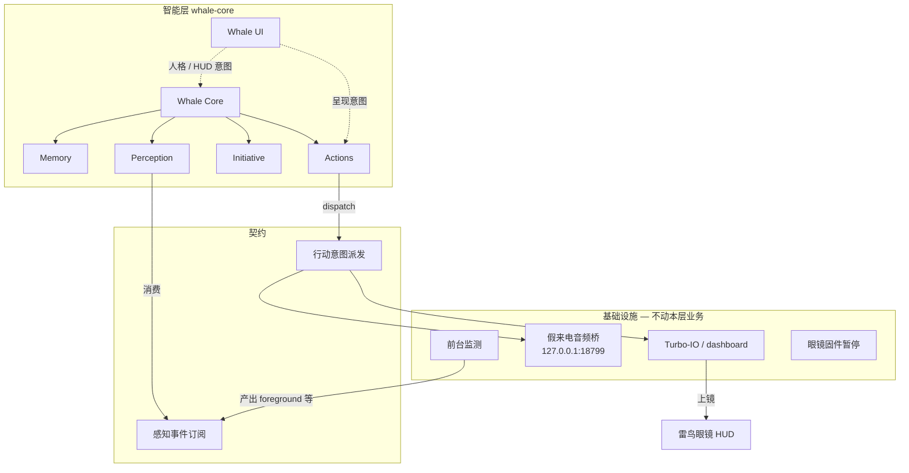
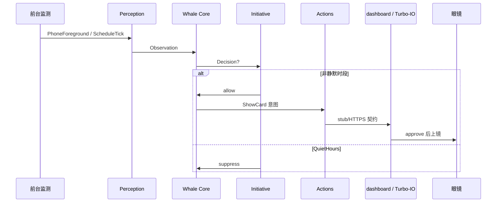

# 分层架构（智能层 + 基础设施）

> 项目总名：**whale-io**（原暂用名「安乡·iO / anxiang-io」已并入本仓）。  
> 原则：**智能层（`whale-core/`）+ 基础设施（`infra/`）同仓分目录**；智能层不写设备细节，只定义意图接口与事件订阅。

## 分层表

| 层 | 名称 | 职责 | 代码位置 |
|----|------|------|----------|
| 智能 | **AI 核心 Whale Core** | 推理与行动选择（perceive → decide → act） | [`whale-core/`](../whale-core/) → `whale_core.core` |
| 智能 | **Memory** | 记忆存储协议与实现 | `whale_core.memory` |
| 智能 | **Perception** | 感知事件类型 + 适配器协议 | `whale_core.perception` |
| 智能 | **Initiative** | 打扰控制 / 主动提醒策略 | `whale_core.initiative` |
| 智能 | **Actions** | ShowCard / PlaceCall / Speak 意图 + Gateway | `whale_core.actions` |
| 智能 | **Whale UI** | 人格、文案、语音风格、HUD 呈现意图 | `whale_core.ui` |
| 基础 | **Turbo-IO / dashboard** | PhoneBridge、云推送上镜、轻量 HUD 执行 | 上游 [Turbo1123/Turbo-IO](https://github.com/Turbo1123/Turbo-IO)（不在本仓） |
| 基础 | **假来电音频桥** | 自管来电 UI + PCM 桥 | [`infra/call-bridge/`](../infra/call-bridge/) |
| 基础 | **前台监测** | 前台 / 最近应用监测与截图 | [`infra/fg-monitor/`](../infra/fg-monitor/) |
| 基础 | **眼镜固件** | **暂停**；无书面说明不刷 | — |

**Whale UI ≠ 上镜管道**：`ui/` 只定人格与呈现意图；真正上镜仍由 Turbo-IO / dashboard 执行。

## 依赖方向

```text
智能层（whale-core）
    → 契约（事件 in / 意图 out）
        → 基础设施（Turbo-IO · 音频桥 · 前台监测 · 固件暂停）
```

禁止：智能层直接写 ADB / 厂商 SDK / 真实 Token；基础设施反向依赖智能层决策逻辑。

## Mermaid：总览



## Mermaid：一条提醒上镜路径（概念）



## 与 overview 的关系

- [overview.md](overview.md) 描述 **基础设施两条通路**（HTTPS 上镜、旁路音频桥）。  
- 本文描述 **智能层如何挂在契约之上**。  
- 安全约定见 [security.md](security.md)；域名示例 `https://rayneo.wangfanlab.com/turbo`。


## 与原设想的关系

用户「原本功能设想」与当前草稿的对照（覆盖判断、优先级、落层、现有 stub、下一刀）见 **[vision-coverage.md](vision-coverage.md)**。

摘要：

- **已设计核心链路**：云端推送到眼镜（HTTPS dashboard → approve → 上镜）。
- **P0 核心缺口**（智能层契约优先补齐）：长期记忆与人格连续性；课程表/位置/天气情境推理；提醒 vs 不打扰（`QuietHours` → `DisturbancePolicy`）。
- **P1**：主动呼叫策略、手机控制意图、环境语音事件元数据。
- **P2**：导航进度提醒、多设备会话、鲸鱼形象渲染设计字段。

智能层实现见 [`whale-core/docs/vision-map.md`](../whale-core/docs/vision-map.md) 与 [`whale-core/docs/contracts.md`](../whale-core/docs/contracts.md)。

## 仓内目录（whale-io）

| 部分 | 路径 |
|------|------|
| 概述与操作指导 | [`docs/`](./) |
| 智能层 | [`whale-core/`](../whale-core/) |
| 假来电 / VoIP 音频桥 | [`infra/call-bridge/`](../infra/call-bridge/) |
| 前台监测 + 截图 | [`infra/fg-monitor/`](../infra/fg-monitor/) |
| Turbo-IO（PhoneBridge / 云推送上镜） | 不在本仓；上游 [Turbo1123/Turbo-IO](https://github.com/Turbo1123/Turbo-IO)，本地改动另行管理 |
