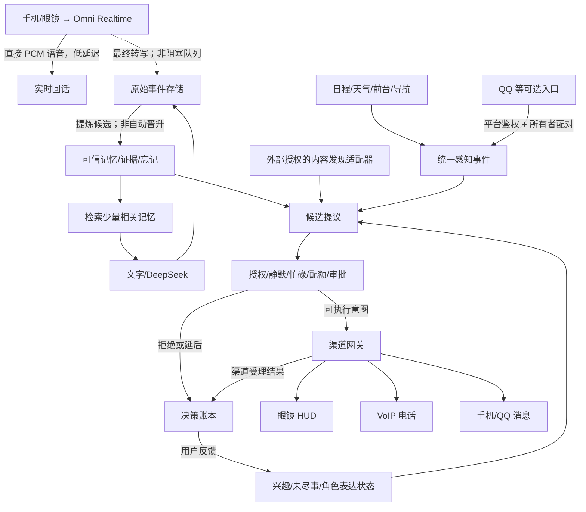
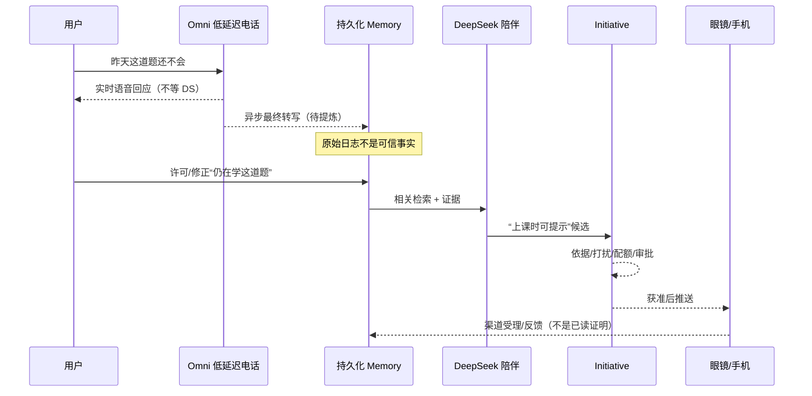

# 陪伴功能怎样组合并真正生效（运行闭环）

> 本文件是数据流、责任边界、验收入口。下文的“目标”不等于线上已部署；当前的 `whale-core/life/` 是**不联网、默认不发消息**的规则与契约原型。

## A. 总的数据流



注意：图里 RAW→CURATE、APP→EVT、PORT→各实际渠道以及 LOG→反馈策略的箭头，部分是**目标接口**，并非全部在线上工作；当前源码的完成度见 [roadmap](companion-roadmap.md)。

## B. 一次“上课别忘带伞”的路径

1. 课程表适配器发出 `context.course`；天气源发出 `context.weather`；粗位置来自 `context.location`。三个事件要有来源、时间与有效期，不使用未核实的聊天片段冒充天气。
2. `ContextReasoner` 组合事实形成情境概述；未来模型可提出“带伞”候选，但不能直接向眼镜发网络请求。
3. `ProactiveOutbox.propose` 记录草稿 ID、文案、依据（课程/天气事件 ID）、目标 `hud`。**相同事件 ID 不重复新建候选**。
4. `inspect` 检查：用户允许 HUD 主动提醒吗？是否上课忙碌、静默、过期、当日超额？未授权就保留草稿。
5. 用户允许或明确批准后，适配器将 `show_card` 发布给 dashboard，收到服务端受理回执；眼镜真正显示仍由手机/Turbo-IO 链路报告，不能拿 HTTP 200 当作“用户看到了”。
6. 用户可以选择不再提醒某类课程/天气组合，后续规划必须过滤该反馈。

**当前现状**：情境事件与规则存在、草稿和门控可跑；真实天气/课表、完整 Dashboard 响应回执、用户设置页尚需联调。

## C. 一次“昨晚聊过的错题，第二天继续”的路径



- 手机与云端**不可直接共享 SQLite 数据文件**；生产环境应将可信记忆服务置于单一受保护端点，跨设备通过受认证 API 与相同 owner_id / conversation_id 使用它。
- `MemoryCurator.remember(..., consent=True, evidence_id=...)` 显式晋升；`recall(query)` 有词项命中、重要度、衰减和证据解释。它目前是词项级启发式检索，尚非语义向量/事实冲突解析。
- `WhaleCompanion(..., curator=curator)` **显式传入后**才使用被审查记忆；旧入口仍能使用最近原始 episode，正式产品建议启用 curated 模式、增加权限 UI。

## D. 一次“它自己发现了个 FPGA 视频”的路径

1. 经用户授权的内容适配器获取 **确实存在** 的视频标题、页面地址、正文/字幕等。没有真实读取就保持 `inspected=False`，不能假装全部看过。
2. `DiscoveryPlanner` 对来源域名做 HTTPS 和白名单检查，用 `InnerState.interests` 进行保守匹配，输出“发现一条内容，要不要看”的草稿，附带原始 URL。
3. `ProactiveOutbox` 保存草稿。**默认主动性关闭，且需要审核**；配额和静默策略限制触发。
4. 渠道接收结果更新账本。若用户“不感兴趣”，记录显式反馈；后续需要真正训练/规则控制时再读取它（目前只保存，未自动学习）。
5. 原项目中的“每日自主观看、双日记、B站公开评论”在 whale-io 仍是**产品目标**，没有加入爬虫、登录 Cookie、自发评论或定时唤醒服务。

## E. 通道与投递协议

- **入口**：外部平台先做身份验证与密钥校验；`OwnerChannelRegistry.accept(Incoming)` 再检查所有者的显式账号配对，产出 `OwnerEvent`。QQ 群聊、陌生人文本和网页内容永远是不可信输入，不能更改权限。
- **候选**：`ProactiveDraft`：`draft_id/text/reason/evidence/channel/importance/created_at/expires_at`。同一 `draft_id` 只保存一次。
- **审批**：`ProactivePrefs` 默认 `enabled=False`、`auto_send=False`、`allow_calls=False`，且渠道默认空集合。语音电话与外部私信始终要求单次确认。
- **分发**：`OutboundPort.send(draft) -> bool` 由外部适配器实现；它的 `True` 仅表示渠道**受理**，不是送达、已读、用户同意。当前没有真正的 QQ/眼镜 outbound port。
- **账本**：`draft → disabled/deferred/needs_approval/ready → attempting → accepted/unknown`。先登记尝试再调用外部服务；状态 `unknown` 不自动重试，以免重复骚扰。用户反馈另记 `life:feedback:<id>`。
- **扩展生产要求**：当前 MemoryStore 的判断与写入没有分布式原子事务；多个进程同时发送时需要**租约/唯一约束/队列 + 提供商幂等键**。凭据仅存外部 Secret Manager，网络消息需要重试和心跳机制但不能不受控重发。

## F. 本地无网络验收

```bash
cd whale-core
python -m pip install -e ".[dev]"
python -m pytest tests/test_life_memory.py tests/test_life_pipelines.py -q
python examples/life_scenario.py
```

运行 `examples/life_scenario.py` 不需要 DeepSeek、B站、QQ 或眼镜账号；它会模拟“真实来源 → 兴趣匹配 → 生成草稿 → 默认阻止 → 人工批准 → 模拟渠道受理”，并展示可追踪的结果。只有经过独立真机/平台测试后，才能标记为用户可用。
