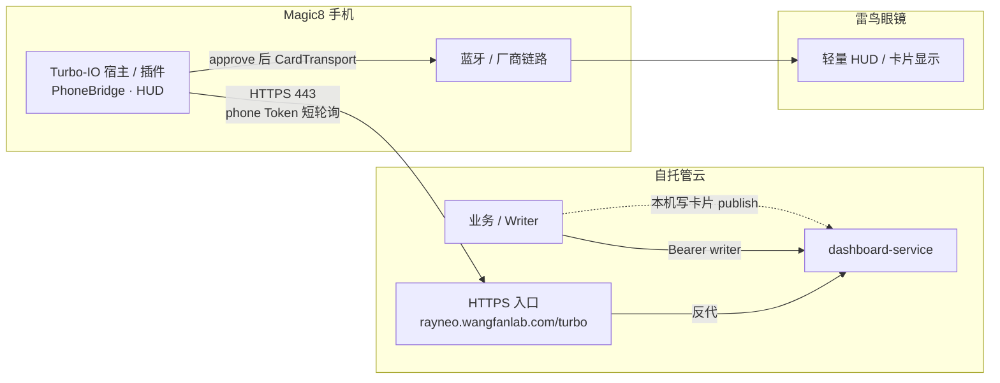
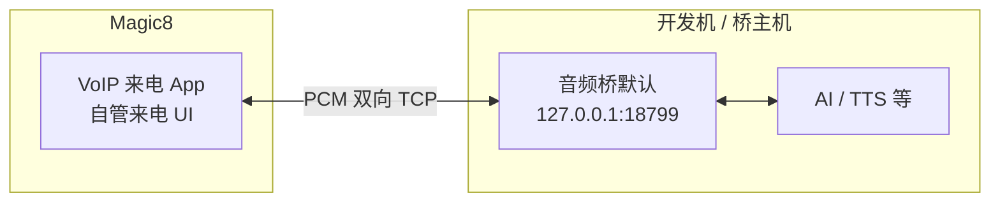

# 架构一页图

整包分两条主通路：**卡片云推送上镜**（正式 HTTPS），以及旁路的 **VoIP 来电音频桥**（本机 / USB reverse / 自配中继）。两者端口与职责隔离。

## 主通路：手机 App ↔ HTTPS dashboard ↔ 眼镜

要点：

1. 手机 **只出站 HTTPS:443**，不向公网开入站端口。
2. 服务端仍强制 `approve`；「自动上镜」是 **客户端** 静默 approve（`phoneAutoApprove=client`），不是跳过鉴权。
3. APK **不**直连本机 reminder / dashboard 明文端口；卡片一律经 HTTPS 入口。

## 旁路：VoIP 来电 + 音频桥

- 默认桥地址写 **`127.0.0.1:18799`**（USB `adb reverse` 或本机中继时）。
- 随身 / 尾网场景用占位主机，**不要**把真实设备 IP 写进文档或提交。
- 与 dashboard **18796**、reminder **18797** 等口隔离，勿混用。

## 模块边界（给新人）

| 你想…… | 先看 |
|--------|------|
| 把提醒 / 卡片推到眼镜 | [cloud-push.md](cloud-push.md) |
| 装实验签名宿主 | [apk-install.md](apk-install.md) |
| VoIP 来电 / AI 通话 | [voip-bridge.md](voip-bridge.md) |
| 什么不能提交 | [security.md](security.md) |

三层优先级与阻塞见 [`framework-status.md`](framework-status.md)。
