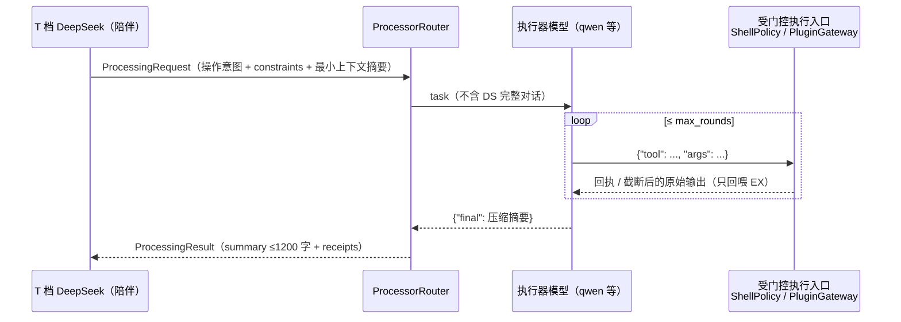

# 插件架构：泛化智能层的输入 / 输出扩展

> **目标**：把 whale-core 从「固定接入点」泛化为**插件化智能层**——新增输入（微信、邮件、日程、刷视频、日常语音、雷鸟全天纪要、电脑桌面……）与新增操作（买东西、写邮件、发信息、桌面通知……）**都不需要改核心代码**，通过开发插件完成。
>
> 实现：[`whale_core/plugins/`](../whale-core/src/whale_core/plugins/) [已测试]。状态标注沿用仓内约定：**[已测试] / [已有代码] / [规划]**。
>
> 结论先行：**能**。核心早已是契约化的（`PerceptionAdapter` / `ActionGateway` / `OutboundPort` 都是 Protocol），本方案把缝隙正式化为「清单 + 注册表 + 泛化事件/动作 + 风险门控」四件套，并把插件分为**六类**（§1.1）：输入型 / 输出型 / 多端共用型 / 内部处理型（维护者定义）+ 模型供给型 / 记忆存储型（架构补齐）；内部处理型支持**操作意图委托**——DeepSeek 产意图、qwen 等执行器模型跑工具循环、只回摘要，陪伴上下文不被命令输出挤满（§1.2）。

## 1. 核心对象

| 对象 | 职责 | 关键点 |
|------|------|--------|
| `PluginManifest` | 能力声明：`inputs`（命名空间事件 kind）+ `actions` + 每个动作的 `action_risk` | 注册时校验；**事件不得冒充核心 kind**（`phone.*` 等前缀拒绝）；**动作名禁止 shell/exec/run 等保留字** |
| `PluginRegistry` | plugin_id → manifest + executor + input_adapter | **显式注册，无自动发现**（不扫 entry_points、不读 env 自动连——qq_onebot 同款约定）；事件 kind 全局唯一归属 |
| `PluginEvent` | 泛化输入：`PerceptionEvent` 子类（kind + plugin_id + payload + trust） | 直接进 `WhaleAgent.perceive` 既有链路，核心零改动 [已测试] |
| `PluginAction` | 泛化输出：意图 kind `plugin_action`（plugin_id + action + target + args） | 风险级**不由意图自declare**，执行时从 manifest 解析，防伪造提权 |
| `PluginActionPolicy` | 风险门控（下节矩阵） | 未注册插件 / 未声明动作 / 未声明风险级一律 denied |
| `PluginGateway` | `ActionGateway` 实现，**策略内嵌的单一执行点** | 拒绝不静默：`plugin-denied:*` / `plugin-hold:*` 回执；挂进 `CompositeActionGateway(plugin=...)` |
| `ProcessorRouter` + `DelegatingIntentProcessor` | 内部处理型（processor）的能力路由与参考实现 | 操作意图委托 + 上下文隔离（§1.2）；摘要强制截断、台账不落 task 全文 |

### 1.1 插件六分类（`PluginKind`）

| kind | 定义 | 例子 | 能力声明 |
|------|------|------|----------|
| `input` 输入型 | 只产事件 | 手机前台「在看什么应用」（第三方源）、邮件接收、日程、刷视频、日常语音、雷鸟全天纪要 | `inputs` |
| `output` 输出型 | 只执行动作 | 发邮件、给电脑弹提示、买东西（transaction） | `actions` + `action_risk` |
| `channel` 多端共用型 | 输入输出双向 | **QQ**、微信、**通话桥**（通话中：工具回执入 / 语音与卡片出） | `inputs` + `actions` |
| `processor` 内部处理型 | 模型/计算委托，无对外 I/O | **操作意图执行器（DS→qwen 委托）**、摘要、翻译、记忆整理 | `provides` 能力名 |
| `model` 模型供给型 | 模型端点注册 | qwen / Seeduplex / realtime 端点、ASR / TTS / 嵌入端点（对应编排四档路由与 `RealtimeProvider` 抽象） | `provides` |
| `memory` 记忆存储型 | 记忆/存储后端 | 混合召回（嵌入+重排）、云同步 API（编排 §3.2 阶段 B）、备份目标 | `provides` |

- 前四类为维护者定义；`model` / `memory` 为架构补齐——把编排方案中「模型端点注册」与「记忆后端替换」两个规划挂载点变成同款插件位。
- kind 可省略并**按能力推断**（只 inputs → input；只 actions → output；两者 → channel）；provider 类（processor/model/memory）必须显式声明 kind 且给出 `provides`，**不得携带 inputs/actions**；显式 kind 与声明能力不一致注册即拒（防「自称只读却带动作」错标）。
- 既有 `life/qq_*`（QQ/WeQ 适配器，#8 已上部署线）按此分类就是标准 **channel** 插件形态——先例可直接套。
- **不可插件化（安全不变量）**：Initiative 频控、ShellPolicy 分档、OwnerChannelRegistry 身份门、PluginActionPolicy 风险矩阵属于核心，任何插件类型都不能替换或削弱。

### 1.2 内部处理型：操作意图委托与上下文隔离

**问题**：让 DeepSeek 陪伴模型直接跑工具循环，shell / 命令 / 检索的原始输出会每一步都回流对话上下文——十几步后上下文被挤满，陪伴质量与成本都被拖累。

**方案**：想与做分离。T 档只产「操作意图」，执行委托给 processor 插件（执行器模型如 `qwen3.8-flash`）：



- **DS 上下文只增加一条摘要**（百字级），无论循环多少步、工具输出多大 [已测试：原始输出不回流不变量]；
- 循环内每次工具调用仍走门控（ShellPolicy 白名单 / PluginGateway 三态回执）；遇 `plugin-hold` / `needs_approval` 回执立即转人审——**执行器模型不能代批** [已测试]；
- `ProcessorRouter` 对回流摘要强制截断（processor 违约也挤不爆上下文）、非法 status 折算 failed、异常不炸调用方；audit 台账不记 task 全文与 constraints；
- `DelegatingIntentProcessor` 为参考实现：model 与 tool_runner 全注入、离线可测；真实模型端点接线属 `model` 类插件或宿主 env 配置（凭据不进 manifest）；
- 对应 [cloud-model-orchestration.md](cloud-model-orchestration.md) §2.1 硬规则 4：T 档不跑工具循环。

## 2. 风险分级与门控矩阵

每个动作在 manifest 声明 `RiskClass`，门控与 `ProactiveOutbox` / `ShellPolicy` 的保守默认对齐：

| 风险级 | 语义举例 | 非 owner | owner 未批准 | owner 显式批准 |
|--------|----------|----------|--------------|----------------|
| `read_only` | 搜邮箱、看日程、查商品 | denied | **ready** | ready |
| `communicate` | 发信息、写邮件、桌面通知 | denied | needs_approval | **ready** |
| `transaction` | 买东西、下单、支付 | denied | needs_approval | **ready**（且过单笔限额 + 日限） |
| 未声明 | — | denied（任何情况，含显式批准） | | |

- **所有插件动作都要求认证 owner**（`is_owner` 由宿主可信路径注入——`OwnerChannelRegistry` 配对成功后，与 `Incoming.meta.owner_authenticated` 同一信任模型；不从外部原文读取，不可自升）。
- **transaction 每笔单独人审**：`max_transaction_amount` 单笔限额 + `max_daily_transactions` 日限（计数由宿主接台账）；不存在「auto_send 代批交易」。
- 台账（`PluginActionPolicy.audit`）只记动作与裁决，**不记 args 全文**（隐私/凭据面最小化）；executor 回执限 120 字且不得含密钥（bridge_tools 脱敏同款约定）。
- 设计说明：`plugin_action` **不进** `SafeDefaultPolicy.SENSITIVE`——它的 fail-closed 门控内嵌在 `PluginGateway`（唯一执行点），再叠加一层会把已批准动作也吞掉。

## 3. 示例插件目录（对应设想清单）

### 输入（`PluginEvent`，只产事件不产音频/截图字节）

| 设想 | plugin_id | 事件 kind 示例 | payload 约定 |
|------|-----------|----------------|--------------|
| 邮件 | `email` | `email.received` / `email.daily_digest` | 发件人、主题摘要（不入库全文附件） |
| 日程 | `calendar` | `calendar.upcoming` / `calendar.changed` | 标题、时间、地点标签（粗粒度） |
| 刷视频 | `video_feed` | `video_feed.watched` | 内容元数据（标题/UP主/时长），沿用 discovery「只消费可信元数据」边界 |
| 日常语音 | `daily_voice` | `daily_voice.segment` | **仅元数据+摘要文本**，原始音频字节不入库（ambient.speech_segment 同款） |
| 雷鸟全天纪要 | `rayneo_minutes` | `minutes.segment` | 纪要片段文本、时间窗；眼镜侧产出，手机/云中转 |
| 微信 | `wechat` | `wechat.message` | 消息文本、会话标识（配对后经 OwnerChannelRegistry） |
| 电脑桌面 | `desktop` | `desktop.focus_window` / `desktop.idle` | 窗口标题、空闲时长；**不截屏入库**（截图走前台监测既有边界） |

### 输出（`PluginAction` → `PluginExecutor`）

| 设想 | plugin_id.action | 风险级 | 备注 |
|------|------------------|--------|------|
| 买东西 | `shop.purchase` | transaction | 限额 + 日限 + 每笔人审 |
| 查商品 | `shop.search_goods` | read_only | |
| 写/发邮件 | `email.send_email` | communicate | 草稿先行：建议经 `ProactiveOutbox` 审批流 |
| 发信息（微信/QQ 等） | `wechat.send_message` | communicate | QQ 已有专用落地（life/qq_*），微信复用同模式 |
| 桌面通知 / 打开应用 | `desktop.notify` / `desktop.open_app` | communicate | 桌面控制**不含任意 shell**——shell 只有 `cloud.shell_policy` 分档一个入口 |

## 4. 怎么用（宿主组装示例）

```python
from whale_core.plugins import (
    PluginAction, PluginActionPolicy, PluginGateway, PluginManifest, PluginRegistry,
)
from whale_core.actions.gateway import CompositeActionGateway

registry = PluginRegistry()
registry.register(
    PluginManifest(
        plugin_id="email", name="邮件插件", version="0.1.0",
        inputs=("email.received",),
        actions=("search_mailbox", "send_email"),
        action_risk={"search_mailbox": "read_only", "send_email": "communicate"},
    ),
    executor=MyEmailExecutor(),      # 插件进程/SDK 调用在 executor 内，核心不 import
    input_adapter=MyEmailPoller(),   # PerceptionAdapter：poll() 产 PluginEvent
)
gateway = CompositeActionGateway(plugin=PluginGateway(registry, PluginActionPolicy(registry)))

# 决策侧产意图（is_owner 由宿主在 OwnerChannelRegistry 配对成功后注入）：
intent = PluginAction(plugin_id="email", action="send_email", target="boss@example",
                      args={"subject": "周报", "body_digest": "..."},
                      is_owner=True, explicitly_approved=False).to_intent()
receipt = gateway.dispatch(intent)   # → "plugin-hold:email:send_email"（待审批）
```

输入侧无需任何胶水：`PluginEvent(kind="email.received", plugin_id="email", payload=...)` 直接进 `WhaleAgent.step([...])`，`Observation.summary` 自动带上 kind [已测试]。

内部处理型（操作意图委托）接线：

```python
from whale_core.plugins import (
    DelegatingIntentProcessor, ProcessingRequest, ProcessorRouter,
)

registry.register(
    PluginManifest(plugin_id="qwen_executor", name="qwen 操作执行器", version="0.1.0",
                   kind="processor", provides=("operation_execution",)),
    provider=DelegatingIntentProcessor(QwenChatClient(), tool_runner=gated_runner),
    # gated_runner 必须走 ShellPolicy / PluginGateway 门控入口
)
router = ProcessorRouter(registry)
result = router.route(ProcessingRequest(
    capability="operation_execution",
    task="查明天上海天气，给老板发周报邮件草稿",
    constraints={"allowed_tools": ("web_search",)},
    context_digest="用户在准备明早的汇报",   # 最小上下文，不传整段对话
    source="qq:owner",
))
# result.summary 回流 DeepSeek 上下文；result.receipts 进台账
```

## 5. 部署两档（插件是不可信代码）

| 档 | 形态 | 适用 | 先例 |
|----|------|------|------|
| **外置进程（推荐）** | 插件独立进程，入站经 HTTP/队列投递 `InboundEvent`/`PluginEvent` 载荷，出站 executor 走本机 API + token | 第三方插件（微信协议端、桌面 agent、购物脚本） | QQ OneBot / WeQ SSE 适配器（#8）——token 内存比较、不读 env 自动连、默认 Null transport |
| **进程内注册** | 宿主组装代码显式 `register()` owner 自写的 adapter/executor | owner 第一方代码 | `life/qq_workflow` 的组合方式 |

**不做自动发现**是刻意选择：插件加载权在宿主部署配置，杜绝「装了包就进决策链」。凭据（微信 token、邮箱密码、支付密钥）只存宿主机 env / secrets（gitignore），manifest 与注册表不含凭据。

## 6. 硬边界（全部 [已测试] 锚定）

1. **shell 唯一入口**：插件动作名保留字（shell/exec/execute/system/command/run/spawn/eval）注册即拒——任意命令只能走 [cloud-operations §3](cloud-operations.md) 的 managed/safe/personal 分档 + 宿主机沙箱。
2. **事件不冒充核心**：核心 kind 与核心命名空间前缀（phone./schedule./location./ambient./context./nav.）拒绝注册；事件 kind 全局唯一归属，跨插件冲突拒绝。
3. **trust / is_owner 不可自升**：`PluginEvent.trust=owner_verified` 与 `PluginAction.is_owner=True` 只能由宿主可信路径设置；策略不因其「声称」而放宽（紧急不可自升同款原则）。
4. **风险未声明即拒绝**：manifest 没写 `action_risk` 的动作，显式批准也 denied。
5. **交易强约束**：transaction 每笔人审 + 限额 + 日限；失败回执不自动重试（`unknown` 语义沿用 Outbox）。
6. **采集边界**：语音/视频/桌面类插件只入元数据与摘要文本，原始音频、截屏字节不入记忆库（ambient 既有约定）。
7. **processor 无直接副作用**：内部处理型的工具调用必须经宿主注入的受门控执行入口（ShellPolicy / PluginGateway）；遇 `plugin-hold` / `needs_approval` 回执立即转人审，执行器模型不能代批；回流摘要被 Router 强制截断（上下文隔离最后防线）。
8. **门控不可插件化**：Initiative 频控、ShellPolicy 分档、OwnerChannelRegistry 身份门、PluginActionPolicy 风险矩阵是核心安全不变量——不存在能替换或削弱它们的插件类型（processor/model/memory 只提供能力，不提供裁决）。

## 7. 状态与验收

- **[已测试]**（53 项）：清单校验（冒充/保留字/形状/**六分类推断与一致性/provider 不得带 I/O**）、注册表（重复/kind 冲突/注销/**provider 挂载与能力解析**）、`PluginEvent` 进 `WhaleAgent` 链路、门控矩阵全格、限额/日限、审计不落 args、网关三态回执、executor 异常不炸派发、Composite 路由、agent 端到端、**ProcessorRouter（未注册 denied/未接线 failed/摘要与回执截断/审计脱敏）、DelegatingIntentProcessor（委托循环/原始输出不回流/allowed_tools 约束/门控回执转人审/rounds 上限/非 JSON 容错/围栏解析）**。
- **[规划，P1]**：第一个真实外置插件样例（邮件 IMAP 只读 + 桌面通知）；`plugin_action` 与 `ProactiveOutbox` 的组合模板（communicate 动作默认走草稿审批流）；宿主插件配置文件（manifest JSON 目录 + token 分离）。
- **[规划，P2]**：微信协议端适配（外置进程，风控责任同 QQ OneBot 声明）；购物 executor 对接真实商城 API（限额从 env 注入）。
- 验收口径：**新增一个 I/O 点 = 新 manifest + executor/adapter + 宿主一行 register()，核心零改动**；任何插件动作可在台账回答「谁触发、什么风险级、谁批准」。

## 8. 相关文档

[architecture.md](architecture.md)（分层与依赖方向） · [cloud-model-orchestration.md](cloud-model-orchestration.md)（模型编排/记忆/人格/频控） · [cloud-operations.md](cloud-operations.md)（shell 分级与端云交互） · [contracts.md](../whale-core/docs/contracts.md)（事件/意图契约） · [persona-cards.md](persona-cards.md)（角色卡） · [security.md](security.md)
